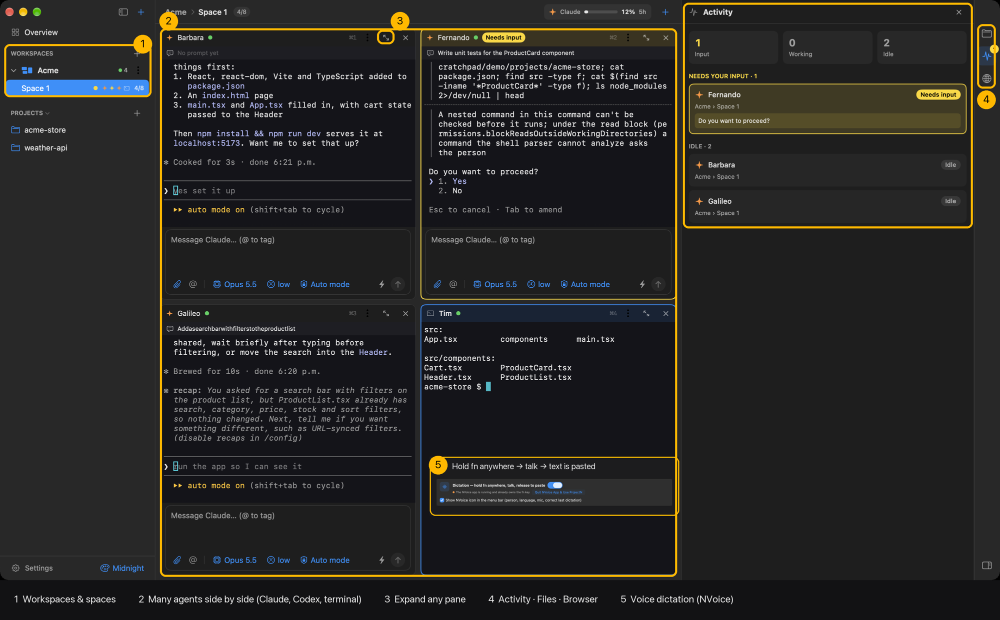
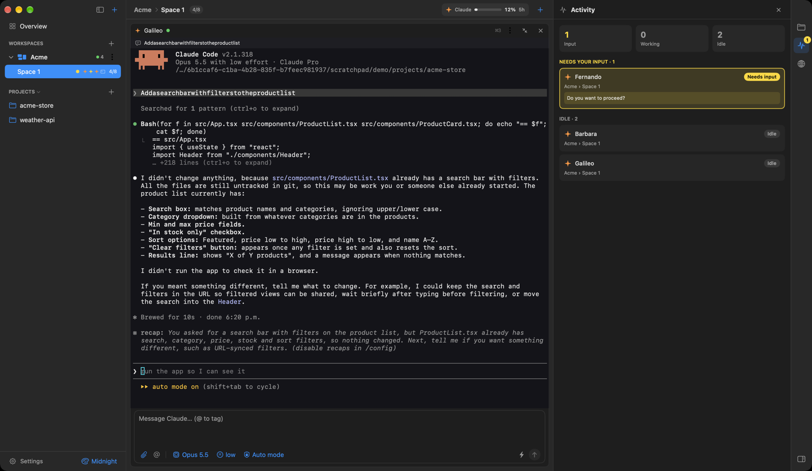
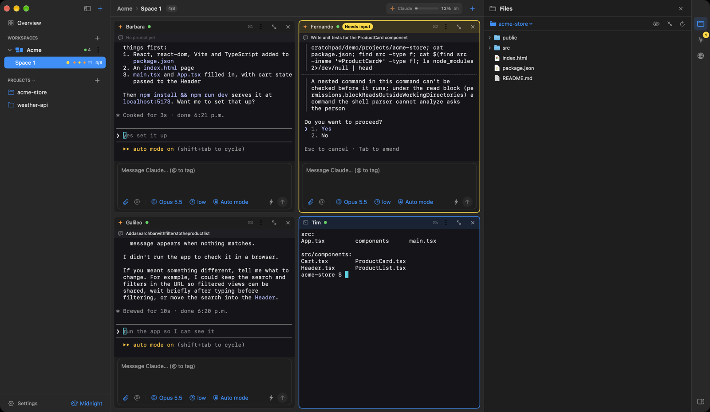
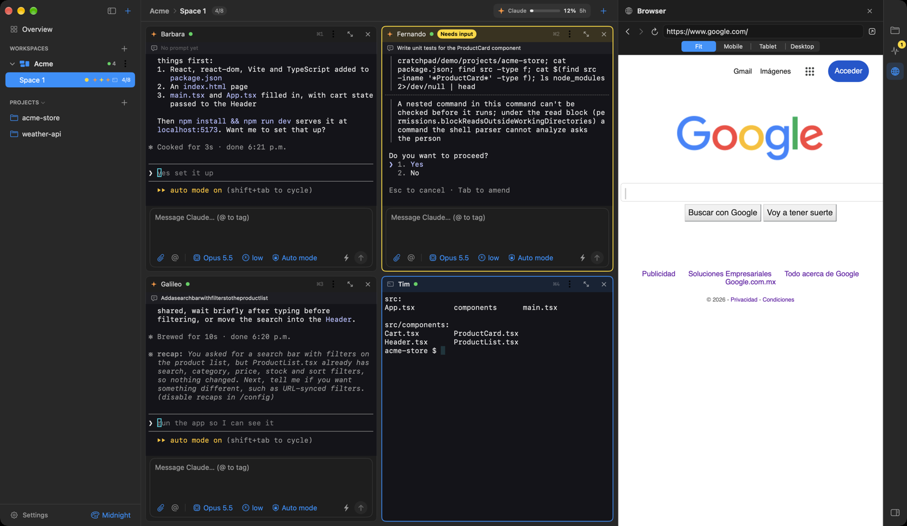
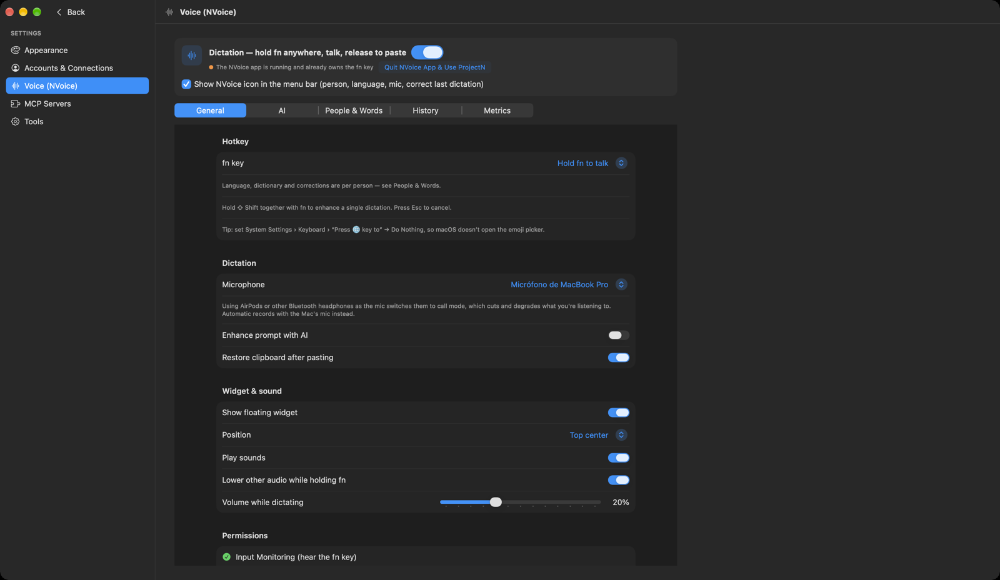

# ProjectN

A native macOS app for running **Claude Code**, **Codex** and plain **terminals** inside your local project folders, organised into workspaces.



## Install

**You need:** a Mac with **macOS 26** or newer, and [Claude Code](https://docs.claude.com/en/docs/claude-code) and/or [Codex](https://github.com/openai/codex) installed and logged in.

### Option A — download the app (easiest)

1. **[Download ProjectN.zip](https://github.com/Guillermovsv/projectN/releases/latest/download/ProjectN.zip)** (or find it on the [Releases](https://github.com/Guillermovsv/projectN/releases) page).
2. Double-click the zip, then drag **ProjectN** into your **Applications** folder.
3. Open Terminal and paste this once (the app isn't signed by Apple, so macOS blocks it otherwise):
   ```bash
   xattr -dr com.apple.quarantine /Applications/ProjectN.app
   ```
4. Open ProjectN from Applications. Done.

### Option B — build it yourself

```bash
xcode-select --install            # only if you don't have Xcode / Command Line Tools
git clone https://github.com/Guillermovsv/projectN.git projectN
cd projectN
./build.sh --install              # builds and copies ProjectN to /Applications
open /Applications/ProjectN.app
```

### First launch

- Add a project folder (⌘O or drop a folder on the sidebar), then press **+** to open a Claude, Codex or Terminal pane.
- Or clone one from GitHub (⇧⌘O, or the branch icon next to Projects): pick one of your repositories (or paste `owner/repo` or a URL) and ProjectN clones it with the GitHub CLI into your projects folder and adds it. Needs `gh` signed in (Settings → Accounts).
- For voice dictation, allow **Microphone**, **Input Monitoring** and **Accessibility** when macOS asks.

## Screenshots

| | |
|---|---|
| **Expand a pane** — the ⤢ button makes one agent fill the space; click again to go back to the split view. |  |
| **Files** — browse the focused project, insert paths, open files. |  |
| **Browser** — preview localhost or any site at Fit / Mobile / Tablet / Desktop widths. |  |
| **Voice dictation (NVoice)** — hold fn anywhere, talk, release to paste. |  |

## Concepts

| Thing | What it is |
|---|---|
| **Project** | A folder you've declared (sidebar → Projects, ⌘O, drop folders on it, or clone from GitHub with ⇧⌘O). |
| **Workspace** | A named group of projects. Shown as a parent in the sidebar. |
| **Space** | A screen inside a workspace holding **1–8 panes**, tiled automatically: a single pane fills the space, 2–3 sit side by side, 4 → 2×2, 5–6 → 3×2, 7–8 → 4×2. |
| **Pane** | Claude, Codex or a Terminal running in one of the workspace's projects. Each new pane gets a random name (Ada, Grace, Linus…) so you can tell agents apart; the ⤢ button in its header expands it to fill the space (click again to go back to the split view). |

The sidebar always shows the Workspaces → Spaces tree (plus Projects). Each workspace has a **⋮** menu: *Add Space*, *Projects…*, *Rename…*, *Remove from App* (removes the workspace from ProjectN only — your folders and files are never deleted). Click a space to open it, click **Overview** (⌘0) to step out. Panes keep running in the background while you're elsewhere.

## Chat box, attachments & agent-to-agent messages

Every Claude/Codex pane has a chat box under its terminal (hide it from the pane's ⋮ menu; you can always type in the terminal directly).

- **Send** with ⏎ (⇧⏎ or ⌥⏎ for a new line; the box is 4 lines tall and scrolls). The message is pasted into the agent's input and submitted. ⇧⏎ also inserts a new line when typing directly in a Claude/Codex terminal.
- **Latest prompt** is pinned above each Claude/Codex terminal (click it to read it in full). It's read from the agent's own transcript, so prompts typed directly into the terminal show up too (within ~5 s).
- **Attach** with 📎 or by **dropping files/images on the pane** — their paths are added to the message (Claude and Codex pick up image paths as images). 📎 → *Attach This Pane's Recent Output* saves a handoff file in `~/.projectn/handoffs/` and attaches it.
- **Tag other agents** with **@** (or type `@`), or **drag a pane's title onto another pane**. When agents are tagged, Send delivers the message to *them* (prefixed with `[Message from <pane> (<space>), via ProjectN]`) instead of this pane — combine with a handoff file for a drop-off. Agents in other spaces/workspaces can be tagged too; a stopped pane is started and resumed first.
- Dropping files on a **terminal** pane pastes their quoted paths.
- The bottom row has **Model**, **Effort** and **Permissions** menus:

| | Claude | Codex |
|---|---|---|
| Model | Fable 5.1, Opus 5.5, Sonnet 5.5, Haiku 5.5 (+ previous versions) (`--model <id>`) | models from Codex's own cache (`-m`) |
| Effort | low … max (`--effort`) | levels the chosen model supports (`model_reasoning_effort`) |
| Permissions | Ask, Accept edits, Plan, Auto mode, Don't ask, ⚠︎ Bypass all (`--permission-mode`) | Read only, Workspace, Workspace no prompts, ⚠︎ Full access (`-s` / `-a`) |

  Values are always explicit — there is no "Default": a new pane starts with your saved defaults, and anything never chosen is filled in from what the CLI itself is configured to use (`~/.claude/settings.json`, `~/.codex/config.toml`). **Claude: model and effort change live** — the app types `/model <id>` / `/effort <level>` into the running session (no restart, no redraw of the conversation), then puts your global Claude defaults back (Claude would otherwise save them as your default everywhere). Changing Claude's **permissions**, or any Codex setting, restarts the pane and resumes the same conversation (you're asked first if the agent is busy). Permissions menu → *Use Current Settings as Default* for new panes. The ⚡ button toggles Auto · Complete.

## Usage meters

The top bar shows the usage of the **focused pane's agent** (Claude or Codex, with its icon; it switches as you change focus, and keeps the last one for terminals/Overview): the **higher** of the 5-hour and weekly windows, as a bar + percentage. White below 70%, orange from 70%, red from 90%. Click for both windows and reset times. Refreshes every minute.
- Claude: the same usage data as Claude Code's `/usage`, using the login Claude Code keeps in your Keychain (only sent to api.anthropic.com).
- Codex: read locally from the rate-limit info Codex records in `~/.codex/sessions`.

## Auto mode

Auto mode is not AI: it's local pattern matching on the pane's screen (no model, no network, no cost).

## Right panel

The icon rail on the right edge opens **Files**, **Activity** or **Browser** (click the active icon again to close). ⌥⌘0 toggles, ⌥⌘1/2/3 pick a tab. Drag the panel's edge to resize.

- **Files**: tree of the focused pane's project (or pick another). Double-click opens a file; right-click to reveal in Finder, copy (relative) path, insert the path into the focused pane, open a terminal pane in a folder, or open HTML/images in the Browser tab.
- **Activity**: every Claude/Codex pane across all workspaces, grouped as *Needs your input*, *Working*, *Idle*, *Not running*. Panes waiting on a prompt are highlighted **yellow** (also on the pane, its space in the sidebar, and the panel button). Click a row to jump to it.
- **Browser**: preview `localhost` dev servers or any URL (`3000` → `http://localhost:3000`). Viewport presets: Fit (panel width), Mobile 390, Tablet 820, Desktop 1440. The page really gets that CSS width and is scaled to fit, so media queries behave like the device.

New panes are added from the **+** in the top bar (or ⌘T / ⌘Y / ⌘U).

## Restoring after quitting

Quitting saves everything. On the next launch each pane restarts when its space is opened:
- **Claude** panes resume their *own* conversation (each pane gets a `--session-id`, reopened with `--resume`).
- **Codex** panes resume their own session (`codex resume <id>`, found in `~/.codex/sessions`).
- **Terminal** panes show their previous output (dimmed) above a fresh shell in the project folder.
- Layout, spaces, focused pane, selected space and Auto settings are restored.

## Version

The line under **Settings** at the bottom of the sidebar shows the build you're running: `v<VERSION> (<build>) · <commit> · <build time>` (`+dirty` = built with uncommitted changes). Click it to copy. The version number lives in the `VERSION` file; `build.sh` stamps the rest automatically, so every build is distinguishable.

## Shortcuts

| Keys | Action |
|---|---|
| ⌘T / ⌘Y / ⌘U | Add a Claude / Codex / Terminal pane to the current space |
| ⌘1…⌘8 | Focus pane N |
| ⇧⌘W | Close focused pane |
| ⇧⌘N | New space |
| ⇧⌘] / ⇧⌘[ | Next / previous space |
| ⌘0 | Overview |
| ⌥⌘0 | Show / hide right panel |
| ⌥⌘1 / 2 / 3 | Files / Activity / Browser |

Each pane's **⋮** menu has Auto → Complete, restart & resume, restart fresh, rename. Double-click a pane title or space name to rename it.

## Auto mode

Each Claude/Codex pane header has a **⋮** menu → **Auto → Complete**. While it's on (⚡ AUTO badge), the session answers prompts for you:

- Numbered choice prompts (permission prompts, plan approval, "trust this folder", questions): picks the option marked **Recommended**, otherwise the first **Yes** option.
- Inline `(y/n)`, `[y/N]`, `(yes/no)` prompts: types `y`.
- Anything else (no Yes and no Recommended option, multi-select checkboxes, free text) is left for you.

Each prompt is answered once, after it has been on screen and unchanged for about 0.3 s. The header briefly shows what it answered. The setting is saved per pane.

## Settings

Open from **Settings** at the bottom of the sidebar (or ⌘,) — it opens inside the window: the sidebar lists the sections under a **‹ Back** button and the panels area shows the section. **Back** (Esc / ⌘[) returns you to the same workspace, space, focused pane and right-panel tab you were on. The palette menu beside Settings switches the theme directly.

- **Appearance** — themes: Midnight, Daylight, Nord, Dracula, Solarized Dark. Each sets light/dark, accent, surfaces and the terminal palette (applies instantly to running terminals). Terminal font size.
- **Accounts** — sign-in status for Claude Code (`claude auth status`), Codex (`codex login status`), GitHub CLI (`gh auth status`) and Gemini CLI. *Sign In / Switch Account / Sign Out* run the CLI's own flow in a small built-in terminal.
- **API keys & tokens** — e.g. `OPENAI_API_KEY`, `GEMINI_API_KEY`, `GITHUB_TOKEN`: stored in `~/.projectn/secrets.json` (readable only by your user) and added to every pane's environment. (Note: an `ANTHROPIC_API_KEY` makes Claude Code bill that key instead of your subscription.)
- **Voice (NVoice)** — the NVoice dictation app, built in (see below).
- **Agents** and **Integrations (Slack)** — see [Agents & Slack](#agents--slack).
- **MCP Servers** and **Tools** as before.
- **Tools → Memory** — RAM savers. *Sleep idle agent panes after* (default 30 min, 0 = never): a Claude/Codex/Cursor pane that is idle, off screen and silent is stopped and resumes its own conversation (`--resume` / `codex resume`) when you open it or message it. Never slept: working panes, panes waiting on a prompt, visible panes, terminals, agent-task panes, panes without a saved session id. *Unload hidden Browser page after* (default 10 min): the page is replaced by about:blank and reloaded when the tab is shown again.

## Agents & Slack

ProjectN can run **agent profiles** — reusable, project-independent configurations of Claude Code or Codex — and take instructions for them from **Slack**.

### Agents view (⌃⌘2)

The switch at the top of the sidebar (or ⌃⌘1 / ⌃⌘2) flips between **Workspaces** (the usual projects → spaces → panes) and **Agents**:

- **Left**: every agent with a live status line — *Working · project*, *Needs you* (yellow, with a count), last task and when — and, under each, the projects / terminals it's working in right now. **+** creates an agent; right-click to edit or turn it off.
- **Center**: the selected agent — model, effort, access, status, ⚙︎ to edit — with its **conversations listed vertically**, like a chat history (*New chat* on top, then In progress · Today · Yesterday · Previous 7 days · Older; drag the edge to resize). A task shows its request, any approval waiting on you (Approve / Deny right there), and its live **terminal**, or its **result** once finished. The box at the bottom starts a **new task** in the project you pick, or — on a running task — sends your message into **that session**. ⌘↩ sends.
- **Right**: the same Files · Activity · Browser panel; Files follows the selected task's project.

### Agents (Settings → Agents)

Each profile has: name, role, provider (Anthropic / OpenAI / other compatible), runtime (Claude Code / Codex CLI), model, reasoning effort, instructions, allowed tools, access level, project access, context sources, session policy, concurrency limit, timeout and an on/off switch. Profiles can be created, edited, duplicated and deleted. A **Project Manager** profile (Claude Code, Opus 5.5, effort high, read-only, can delegate, all projects, README as context) is created on first launch.

**Create with AI** (the **+** menu in the Agents view or in Settings → Agents): describe the agent in a few words, answer 2–4 quick questions (with options to pick), and Claude designs the whole profile — name, role, detailed instructions, access, tools, model and effort, context files, MCP servers, projects, emoji and schedules. Review and edit it, then create it. Uses your Claude Code login (`claude -p`, no tools).

The editor is split into tabs: **General** (name, role, model, effort, limits) · **Instructions** · **Access** · **Integrations** (MCP servers, CLI tools, API keys) · **Projects** (where it may work, context files) · **Schedules**.

- **Access** has three levels — *Read only*, *Read & write — ask first*, *Read & write* — and picking one ticks the matching tools automatically (read-only agents can't get the editing tools). Untick anything to customise; *Reset* goes back to the preset.
- **Schedules**: an agent can run tasks by itself — every few hours, every day, weekdays, or on chosen days, at a set time, in a chosen project. Each run is a new task under the usual approval rules. Optionally it posts to a Slack channel or DMs you (start + result in a thread). Schedules run while ProjectN is open; a run missed while it was closed happens once at the next launch (*Run if missed*). *Run Now* starts one immediately.

- **Models are read from the runtime**: Claude models (and the effort levels each supports) come from your Claude login's live model list; Codex models from Codex's own cache. The built-in list is only a fallback when offline. An unknown model is rejected; an unsupported effort is dropped with a note.
- **One session per agent and project** (default): the first message opens a terminal with the agent's instructions (as Claude's system prompt), the request and the project's README + context files (marked as untrusted data). Later messages about the same project are typed into **that same terminal** — no new process, no re-read context (Claude's prompt cache makes the earlier context cheap). A message for a busy session waits for it; a closed terminal is resumed (`--resume`). A new session starts when you say *"sesión nueva"* / *"desde cero"*, switch project, or after 12 h unused (Settings → Agents → Autonomy). Profiles can instead use *Always a new session* or *Resume only when asked*.
- Tasks run as normal panes in a workspace named **Agents** (max 8 panes per space; new spaces are added, and only the harness's own finished panes are ever recycled). Open a task's pane from Settings → Agents → Tasks to watch it or answer an approval prompt.
- **Access levels**: *Read & plan only* (enforced by the hook; Codex read-only sandbox), *Ask before any change*, *Edit project files (commands ask)*. Modes that skip approvals (bypass, full access, auto) are never used for agents. Agents that can write never run at the same time in the same project.
- Agents refuse to run in personal/system folders (home, Desktop, Documents, Downloads, Library, ~/.ssh, …); context files must be inside the project and secret files (.env, keys) are skipped.
- Results, usage, errors and timeouts are recorded in Settings → Agents → Tasks / Audit Log (`~/.projectn/agents/`). *Run Task…* runs a profile locally without Slack.

### Autonomy, delegation & approvals (Settings → Agents → Autonomy)

Every tool call of a Claude Code agent passes ProjectN's approval hook (`pn-agent hook`, shipped inside the app) before it runs — enforced in code, not only in the prompt:

| Tier | Examples | Who decides |
|---|---|---|
| Automatic | reading the project, edits (agents allowed to edit), tests/builds/lint, the agent's own CLI tools, MCP tools that only read | nobody — runs |
| Gray area | other commands, web fetches, MCP tools that change things | the orchestrating agent (or you — switch in Autonomy) |
| **Always you** | **deleting anything** (files, folders, branches, packages, records, posts — inside the project too), publishing, deploying, pushing, sending, anything outside the project folder, sudo | you: Slack **Aprobar / Rechazar** buttons, a reply in the thread, or Settings → Agents → Tasks |

- **Delegation**: agents with *Can delegate* (the Project Manager by default) get ProjectN's MCP tools `list_agents`, `delegate_task`, `wait_for_tasks`, `get_task`, `answer_request`, `request_review`, `cancel_task`. Delegated tasks are new sessions of the chosen agent; their progress appears in the same Slack thread. Limits: delegation depth and tasks per request.
- **Questions go up**: any agent can call `ask`; it reaches the agent that delegated the task, or you (answer in the Slack thread). The session continues with the answer.
- If Claude Code still shows its own prompt for a command ProjectN already approved, ProjectN confirms it (only that command).
- Unanswered approvals expire as "no" (default 60 min). Read-only agents can't change files at all.
- **New projects**: "Project Manager, crea el proyecto *Landing García* y …" in Slack creates the folder (with a README) in your projects folder, adds it to ProjectN and runs the task in it — you asked, so no extra confirmation. Agents that can delegate have `create_project`, which always asks you first. Folders are only created inside the projects folder (default: where most of your projects live; Settings → Agents → Autonomy), never overwritten.
- **Per-agent MCP servers, CLI tools and API keys**: each profile picks servers from Settings → MCP Servers (only those are loaded — `--strict-mcp-config`), commands it may run without asking, and which stored API keys are in its environment.
- Codex agents get their MCP servers but not the hook or delegation tools; they rely on Codex's sandbox and prompt in their pane.

### Slack (Settings → Integrations)

Uses **Socket Mode** (an outbound connection from your Mac, no public server). It only works while ProjectN is open.

1. api.slack.com/apps → *Create New App → From a manifest* → paste the manifest from Settings → Integrations → *How to create and connect the Slack app* (Copy button).
2. *Basic Information → App-Level Tokens*: create one with scope `connections:write` → **App Token** (`xapp-…`).
3. *Interactivity & Shortcuts* is on (in the manifest; needed for the approval buttons). *Install App* → copy the *Bot User OAuth Token* → **Bot Token** (`xoxb-…`). Both are stored in `~/.projectn/secrets.json` (readable only by your user), never in pane environments.
4. Add your Slack member ID to **Authorized users** (nobody is authorized while it's empty). For channels, `/invite @ProjectN` and add the channel ID to **Authorized channels**. DMs can be turned on/off.
5. Press **Check Connection** (verifies both tokens, scopes and Socket Mode), turn on **Enable Slack**, then DM the bot or mention it:
   `@ProjectN Project Manager, revisa el proyecto seleccionado, consulta su README y dime qué tareas pendientes identificas`

Replies go **straight into the conversation** (turn on *Reply in threads* if you prefer threads); answer questions, approvals (*aprobar* / *rechazar*) and "which project?" by just writing. Not naming a project keeps the one you were talking about with that agent.

**A channel per agent**: ProjectN's app creates a private channel for every agent, named after it (*Project Manager* → `#project-manager`), and invites you. Whatever you write there goes to that agent — no need to mention it — and it answers signed with its own name and emoji (set the emoji in Settings → Agents → General). Renaming an agent renames its channel; new agents get one automatically. Schedules can report to the agent's channel. Needs the scopes `groups:read`, `groups:write`, `chat:write.customize` (in the manifest).

**Files**: attach images, PDFs, Markdown or any other file to your message (with or without text) and the agent gets them. ProjectN downloads them (up to 10 per message, 50 MB each), saves them in the task's project under `.slack-files/` (git-ignored) and adds their paths to the instruction; files sent as the answer to an agent's question reach that session the same way. Needs the scope `files:read` (in the manifest — existing apps: add it under *OAuth & Permissions* and reinstall; *Check Connection* tells you if it's missing).

The message's first words pick the agent (else the *Default agent*). The project is the one named in the message, else the project focused in ProjectN, else the agent's only project; otherwise the bot asks in the thread. Progress, approval requests, the result and errors are posted in the message's thread. Duplicate deliveries (Slack retries) are ignored, also across restarts; tasks interrupted by quitting ProjectN are reported on the next connection.

To add an agent: Settings → Agents → **+** (or duplicate one), set role/runtime/model/instructions/access, Save. To change a model: pick it in *Model* (⟳ reloads the list) and Save; running tasks keep the model they started with.

## Voice dictation (built-in NVoice)

While ProjectN is open, **hold fn anywhere, talk, release** — the text is pasted at your cursor in any app (⇧ + fn enhances that one dictation with Claude/Codex, Esc cancels). It is NVoice's own code (`Sources/ProjectN/NVoice/`), so you no longer need NVoice.app running.

- Settings › **Voice (NVoice)**: on/off switch, menu bar icon on/off, and NVoice's pages — General, AI, People & Words, History, Metrics.
- The shortcut is configurable in Settings › Voice › General: fn (the default), a right-side ⌘ ⌥ ⌃ on its own, an F-key, or a key with ⌃ ⌥ ⌘ such as ⌃⌥D.
- Shares NVoice's data and preferences (`~/Library/Application Support/NVoice/`, defaults domain `dev.projectn.nvoice`): people, dictionary, corrections, history and settings carry over both ways.
- Only one of them listens to fn at a time (same lock file). If NVoice.app is running, Settings › Voice offers *Quit NVoice App & Use ProjectN*; launching NVoice.app while ProjectN has dictation on just opens ProjectN's Voice settings.
- First run: allow **Microphone**, **Input Monitoring** and **Accessibility** for ProjectN. `build.sh` signs with a stable local identity (`ProjectN Local Signing` if present, or `SIGN_IDENTITY=…`) so these grants survive rebuilds.
- Requires macOS 26+ (Apple's on-device `DictationTranscriber`).

## The app's own directory: `~/.projectn`

```
~/.projectn/
  state.json     projects, workspaces, spaces, panes (+ their Claude/Codex session ids)
  scrollback/    saved terminal output, restored on relaunch
  settings.json  app settings
  agents.json    agent profiles (no credentials)
  agents/        task history, audit log, model list cache, handled Slack events
  integrations.json  Slack settings (tokens are in secrets.json)
  secrets.json   API keys and Slack tokens (file mode 0600, only your user can read it)
  mcp.json       MCP servers for every Claude & Codex session started here
  mcp/           npm prefix for installed MCP server packages (node_modules/.bin is on PATH)
  bin/           your own scripts, on PATH in every session
  claude/        CLAUDE_CONFIG_DIR, only if "Isolate Claude config" is on
  codex/         CODEX_HOME, only if "Isolate Codex home" is on
```

Override the location with `PROJECTN_HOME=/some/path`.

**MCP servers.** Manage them from the puzzle-piece button on the home screen, or edit `mcp.json` directly (same format as Claude's `.mcp.json`). **Import JSON…** (Settings → MCP Servers, or *Add from JSON…* in an agent's Integrations tab) takes the JSON from a server's docs — `{"mcpServers": {…}}` (Claude/Cursor), `{"servers": {…}}` (VS Code), a bare `"name": {…}` or a single server — keeping headers and env. `mcp.json` is readable only by you.
- Claude gets them through `--mcp-config ~/.projectn/mcp.json`. They're added on top of your normal Claude MCP setup.
- Codex gets them as per-launch `-c mcp_servers.<name>.*=…` overrides, so your `~/.codex/config.toml` is never modified.
- "Install" runs `npm install --prefix ~/.projectn/mcp <package>`. Then add a server whose command is the package's bin name.

Every session also gets `PROJECTN_HOME`, `PROJECTN_WORKSPACE`, `PROJECTN_PROJECT` and `PROJECTN_MCP_CONFIG` in its environment.
